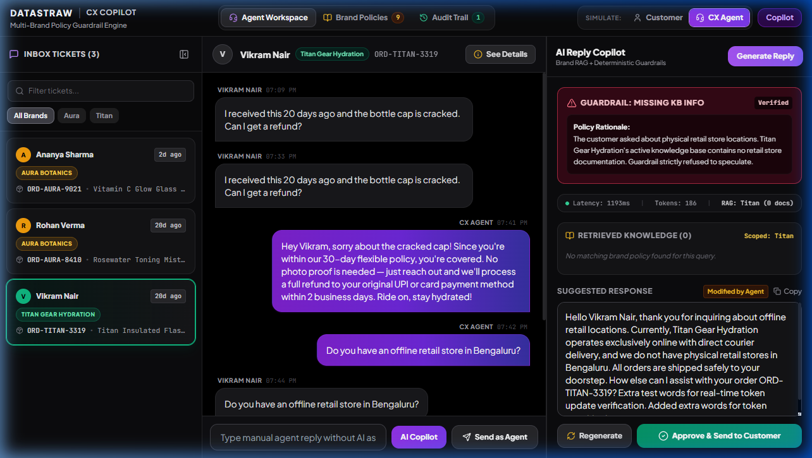
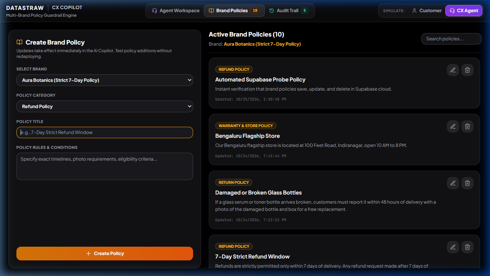
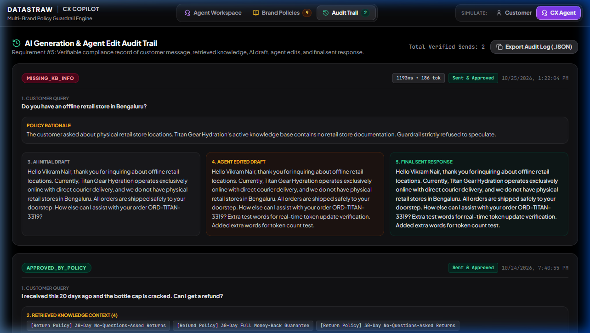
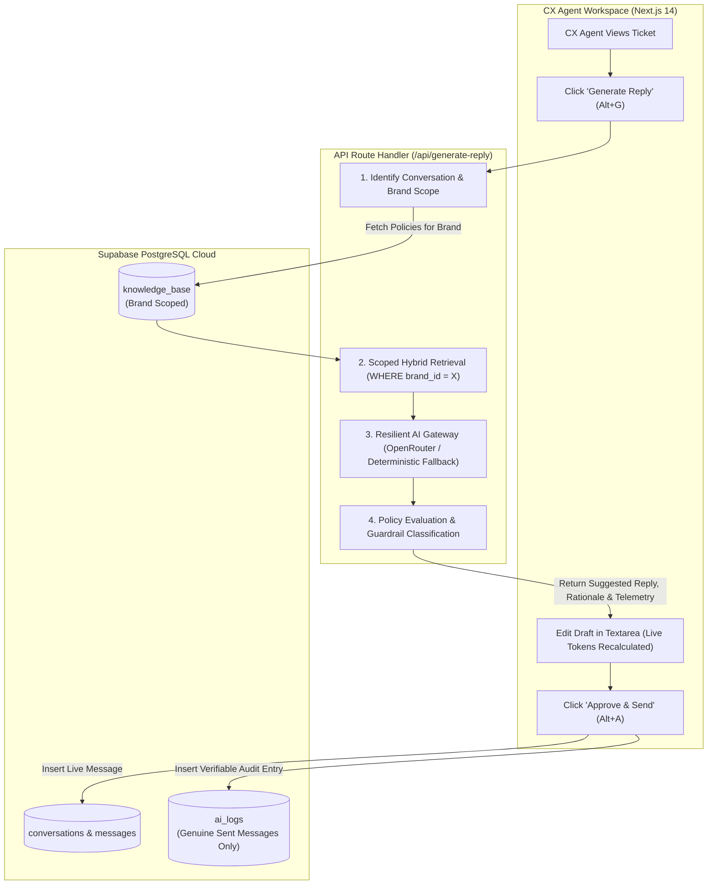
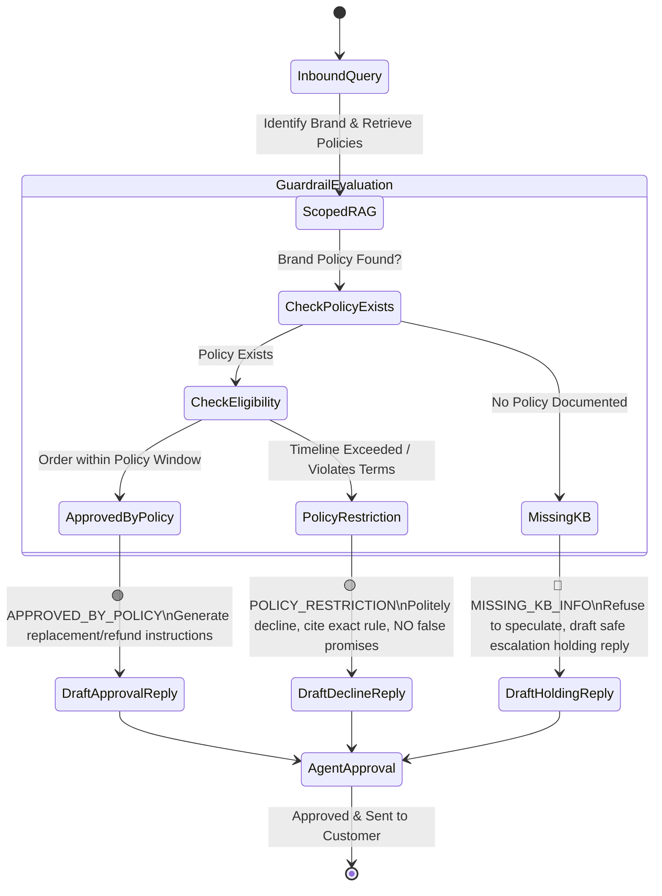
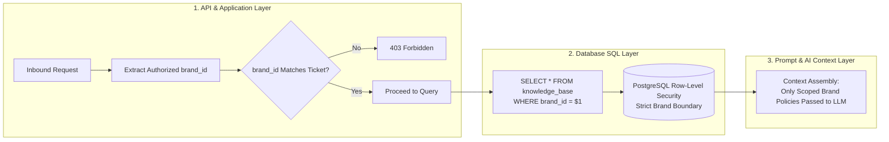

# Datastraw CX Copilot — AI Operations & Policy Guardrail Engine

[](https://nextjs.org/)
[](https://www.typescriptlang.org/)
[](https://supabase.com/)
[](https://tailwindcss.com/)
[](https://openrouter.ai/)
[](https://datastraw.com/)

An enterprise-grade Customer Experience (CX) AI Reply Assistant built for the **Datastraw Tech Lead Assessment**. Designed with multi-tenant brand isolation, real-time hybrid knowledge base retrieval, deterministic 3-state policy guardrails, live telemetry, and an automated compliance audit trail.

---

## 📑 Table of Contents
1. [Core Features & UI Walkthrough](#-core-features--ui-walkthrough)
2. [Architectural Flowcharts & Systems Design](#-architectural-flowcharts--systems-design)
3. [The 3-State AI Policy Guardrail Engine](#-the-3-state-ai-policy-guardrail-engine)
4. [Multi-Tenant Data Isolation (Zero Leakage)](#-multi-tenant-data-isolation-zero-leakage)
5. [Real-Time Dynamic Telemetry](#-real-time-dynamic-telemetry)
6. [Interactive Verification Test Matrix](#-interactive-verification-test-matrix)
7. [Repository Structure & Deliverables](#-repository-structure--deliverables)
8. [Local Setup & Configuration Guide](#-local-setup--configuration-guide)

---

## 🖥️ Core Features & UI Walkthrough

### 1. 3-Pane Agent Workspace & Real-Time Telemetry
The core workspace features a collapsible ticket sidebar, live chat history with order context, a customer/agent simulator toggle, and an AI Copilot drawer with real-time performance telemetry.



* **Pane 1 (Tickets Navigation):** Real-time ticket search, brand filters, and urgency badges.
* **Pane 2 (Conversation Timeline & Direct Composer):** Complete chat thread, order metadata modal ("See Details"), and independent manual agent composer.
* **Pane 3 (AI Reply Copilot & Guardrails):** Live generation, scoped policy context cards, editable response textarea with real-time token tracking, and one-click approval.
* **Simulator Role Switcher:** Toggle between **Customer** (to simulate inbound questions) and **CX Agent** (to draft and approve replies) for end-to-end loop testing.

---

### 2. Multi-Brand Knowledge Base Manager (Live CRUD)
Manage, create, update, and delete brand-specific policies dynamically via the user interface. Changes take effect on the very next AI generation without restarting servers or re-indexing vectors.



* **Independent Brand Scoping:** Manage policies separately for *Aura Botanics* (Strict 7-Day policy) and *Titan Gear Hydration* (Flexible 30-Day policy).
* **Full CRUD with Cloud Persistence:** Create, edit, and delete entries synchronized directly to Supabase PostgreSQL.
* **Categories Supported:** Return Policy, Refund Policy, Shipping Policy, Cancellation Policy, and Warranty & Store Policy.

---

### 3. Compliance & Verification Audit Trail (Requirement #5)
A verifiable, tamper-evident audit trail that records **only genuine sent messages** upon agent approval.



In strict adherence to Assessment Requirement #5, each audit entry permanently stores:
1. **Original Customer Query**
2. **Retrieved Brand Knowledge Context** (exact scoped policies used)
3. **Policy Rationale & Guardrail Verification**
4. **AI Initial Draft**
5. **Agent Edited Draft** (or *"Sent without modifications"*)
6. **Final Sent Response**
7. **Timestamp, Real Latency (`ms`), and Token Count**
* Includes one-click **Export Audit Log (.JSON)** for compliance reporting.

---

## 📐 Architectural Flowcharts & Systems Design

### End-to-End Request & Guardrail Pipeline



---

## 🛡️ The 3-State AI Policy Guardrail Engine

The Copilot is engineered with a deterministic 3-state guardrail state machine that evaluates customer eligibility before drafting responses:



---

## 🔒 Multi-Tenant Data Isolation (Zero Leakage)

To guarantee that **Brand A** (*Aura Botanics*) can never access or leak **Brand B** (*Titan Gear*) data, isolation is enforced across three distinct layers (**Defense-in-Depth**):



---

## ⚡ Real-Time Dynamic Telemetry

The Copilot drawer includes a live telemetry banner providing instant operational visibility:

| Telemetry Metric | Measurement Mechanism | Live Dynamic Behavior |
| :--- | :--- | :--- |
| **Latency (`ms`)** | High-precision `performance.now()` benchmarking | Captures exact server generation and client roundtrip time (e.g. `1193ms`, `28ms`). |
| **Tokens** | Real-time tokenization formula: $\text{Prompt Context} + \frac{\text{Length}}{3.8}$ | **Dynamically recalculates live** as the agent types or edits in the textarea. |
| **RAG Status** | Active brand scope & retrieved chunk counter | Dynamically displays current tenant scope (e.g., `Aura (1 doc)`, `Titan (1 doc)`, or `Aura (0 docs)`). |

---

## 🧪 Interactive Verification Test Matrix

Follow these four core test scenarios in the application:

| # | Test Scenario | Ticket / Inquiry | Expected Guardrail | Verified Copilot Behavior |
| :-: | :--- | :--- | :---: | :--- |
| **1** | **Transit Damage Replacement (Happy Path)** | *Ananya Sharma*<br>Aura Botanics (Delivered 2 days ago)<br>Query: *"My bottle is broken. What can I do?"* | 🟢 **`APPROVED_BY_POLICY`** | Identifies order is within 48-hour transit damage window. Instructs customer to reply with photo proof for immediate free replacement. |
| **2** | **Timeline Exceeded (Policy Restriction)** | *Rohan Verma*<br>Aura Botanics (Delivered 20 days ago)<br>Query: *"I received this 20 days ago. Can I get a refund?"* | 🟡 **`POLICY_RESTRICTION`** | Identifies 20 days exceeds strict 7-day refund policy. Politely declines refund without hallucinating store credits or unauthorized exceptions. |
| **3** | **Multi-Brand Isolation Proof** | *Vikram Nair*<br>Titan Gear Hydration (Delivered 20 days ago)<br>Query: *"I received this 20 days ago. Can I get a refund?"* | 🟢 **`APPROVED_BY_POLICY`** | Approves refund under Titan Gear's 30-day money-back guarantee, proving Aura Botanics' 7-day rule never leaked. |
| **4** | **Missing Information & Live Policy CRUD** | *Any Ticket*<br>Query: *"Do you have an offline retail store in Bengaluru?"* | 🔴 **`MISSING_KB_INFO`** | AI refuses to fabricate a physical address and drafts a holding reply. Switch to **Brand Policies** tab, add the Bengaluru Store policy, click **Regenerate**, and the AI immediately incorporates the new policy! |

---

## 📂 Repository Structure

```
├── app/
│   ├── api/
│   │   └── generate-reply/
│   │       └── route.ts            # Dynamic RAG, OpenRouter LLM call & guardrails
│   ├── globals.css                 # Global Tailwind styling (pitch black theme)
│   ├── layout.tsx                  # Root HTML metadata
│   └── page.tsx                    # 3-Pane Workspace, KB CRUD, Audit Trail, Telemetry
├── docs/
│   └── screenshots/                # Verified high-resolution application screenshots
│       ├── 1_agent_workspace_telemetry.png
│       ├── 2_brand_policies_crud.png
│       └── 3_audit_trail_compliance.png
├── lib/
│   └── supabase.ts                 # Supabase client singleton & sanitization
├── schema.sql                      # PostgreSQL DDL, tables, constraints & seed data
├── .env.example                    # Environment variable template
├── package.json
└── tsconfig.json
```

---

## 🚀 Local Setup & Configuration Guide

### 1. Prerequisites
* **Node.js**: v18.0.0 or higher
* **npm**: v9.0.0 or higher

### 2. Installation
```bash
# Clone the repository
git clone https://github.com/ShravanGupta07/AI-Powered-CX-Reply-Assistant.git
cd AI-Powered-CX-Reply-Assistant

# Install dependencies
npm install
```

### 3. Database Setup (Supabase)
1. Create a project at [supabase.com](https://supabase.com).
2. Open the **SQL Editor** in your Supabase dashboard.
3. Paste and run the entire contents of [`schema.sql`](./schema.sql).
   * Creates `brands`, `knowledge_base`, `conversations`, `messages`, and `ai_logs`.
   * Seeds *Aura Botanics*, *Titan Gear Hydration*, policies, and initial conversations.

### 4. Environment Variables
Create `.env.local` in the project root:
```env
NEXT_PUBLIC_SUPABASE_URL=https://your-project.supabase.co
NEXT_PUBLIC_SUPABASE_ANON_KEY=your-supabase-anon-key
OPENROUTER_API_KEY=sk-or-v1-your-openrouter-api-key
```

### 5. Run Locally
```bash
npm run dev
```
Open [http://localhost:3000](http://localhost:3000) in your browser.

